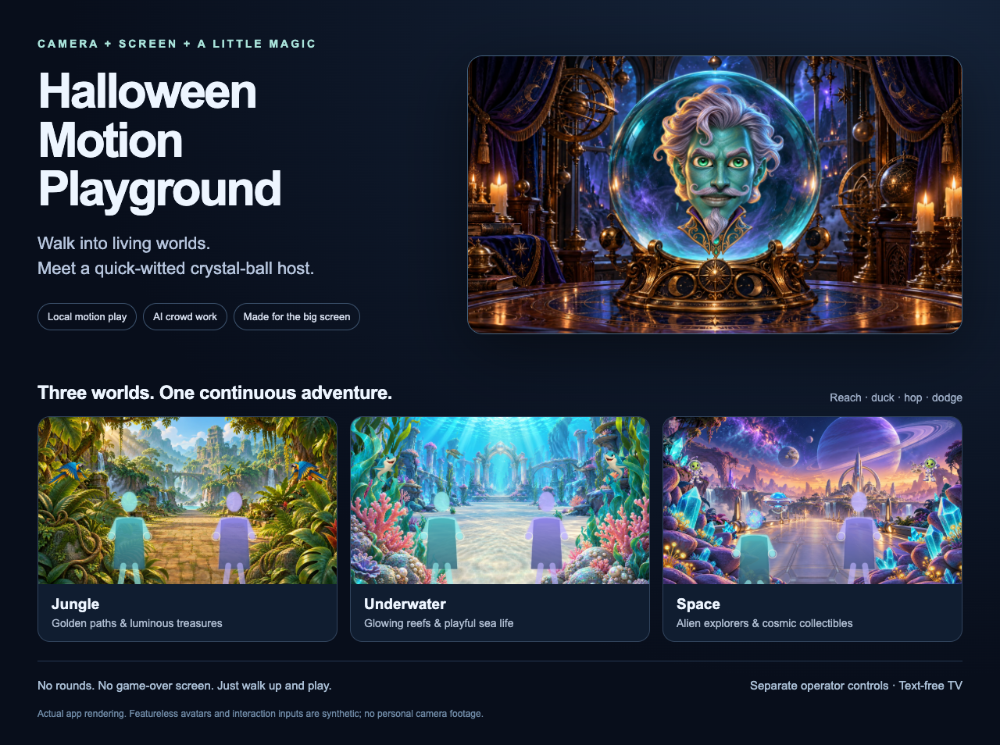
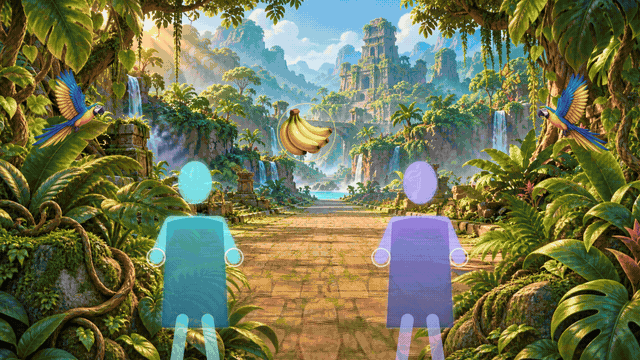

<div align="center">

# Halloween Motion Games 2026

**Turn a camera and a screen into a walk-up attraction.**

[See it move](#see-it-move) · [Get started](#get-started) · [Run the show](#run-the-show) · [Privacy & keys](#privacy--keys)



</div>

Two experiences share a simple event setup: a camera watches the play area, a big screen becomes the stage, and a separate control room stays with the operator.

| Motion Games | Spooky Host |
| --- | --- |
| Reach into a living world and collect glowing treasures. Duck, gently hop or step aside as playful obstacles pass. | Meet an original crystal-ball oracle that notices visible costumes and actions, then delivers short, playful crowd-work lines. |
| **Local and offline after setup.** No API key or paid model requests. | **Online AI, explicitly started.** Uses an OpenAI API key and metered API usage. |
| Jungle, underwater and space themes with identical mechanics and seamless switching. | Animated attention, speech-driven jaw movement, magical voice effects, tone controls and operator rescue buttons. |

## See it move

### One continuous adventure, three living worlds



*Actual production renderer and collision logic. Featureless avatars and tracked poses are staged synthetic inputs; this is not webcam footage or a tracking-accuracy demonstration. The 12-second capture contains five interaction rewards. Playback is silent.*

- **Walk up, play, walk away.** Scenery keeps moving even when nobody is in frame. No rounds, scores or game-over interruptions.
- **Reach, duck, hop and dodge.** Large targets, forgiving contact areas and brief celebrations keep the next action readable.
- **Share the screen.** Local tracking supports up to three poses; lighting, costumes, overlap and camera placement affect real-world results.
- **Change the world live.** Jungle paths, luminous reefs and alien landscapes share the same mechanics. Switching themes preserves play and tracking.
- **Set the pace and music.** Live density controls, original locally synthesized soundtracks, volume and mute stay in the control room.

### An oracle with a little attitude


*Actual Host renderer in a silent animation rehearsal, using simulated attention and speech amplitude. No live AI response, microphone, camera footage or guest interaction is represented in this GIF.*

The Host receives up to three recent chronological image frames per observation, so it can react to visible changes rather than relying on a single snapshot. It is periodic visual context, not a continuous video conversation, and it does not listen to guests.

- **Grounded crowd work:** short setup-and-punchline prompts based on clear costume details or voluntary gestures.
- **Less repetition:** a session-only ledger excludes played observation and joke-premise families before generating more speech. Silence is allowed when nothing fresh is clear.
- **Expressive character:** independently animated eyes, eyelids, brows, head, collar and an audio-amplitude-driven jaw.
- **Magical voice:** deep delivery with adjustable local echo/reverb and a dry bypass.
- **Operator control:** welcome a group, offer a visual challenge, wrap up, or use **Quiet now** to cancel speech and suppress Auto until resumed.
- **Audience-aware tone:** family-friendly defaults, an adjustable dial and explicit adults-only confirmation for stronger language and non-graphic innuendo. Mixed or uncertain audiences stay family-safe. Appearance is not age verification.

Live joke quality, grounding and latency vary. Repetition checks are conservative safeguards, not a guarantee that every paraphrase is detected. The jaw animation follows speech energy rather than phoneme-level lip sync.

## Get started

### From source

You need **Node.js 22+**, npm and **Google Chrome**. Initial dependency and pinned vision-asset setup requires internet access. A camera and an extended TV/projector display are optional until you rehearse the full installation.

```sh
git clone https://github.com/ghidtm44/halloween-motion-games-2026.git
cd halloween-motion-games-2026/apps/simple-playground-v1
npm ci
npm run assets
npm run build
```

Start the offline Motion Games edition on macOS/Linux:

```sh
PLAYGROUND_EDITION=motion PORT=4328 npm start
```

Open **http://127.0.0.1:4328** in Chrome. On Windows, set those two environment variables using your shell's syntax before `npm start`.

For the app including Spooky Host, run `npm start` without the Motion Games environment variables, then open **http://127.0.0.1:4318**. Scripted rehearsal works without an API key. Configure a server-side key only when you want live AI.

### Native Mac apps

The native launcher packages the production app, Node runtime and local vision assets into a self-contained `.app`. Building requires **macOS 13.5+**, Apple Command Line Tools and network access during assembly. Chrome must be installed at `/Applications/Google Chrome.app`.

```sh
# Run from the repository root.
bash launchers/macos/native/build-app.sh --motion-games
bash launchers/macos/native/build-app.sh
```

These build separate Motion Games and Host editions into fresh staging folders. They do not install over an existing app or start a camera. Follow the [Mac build and installation guide](launchers/macos/native/BUILD.md) before copying a bundle. Local builds are ad hoc signed, not Developer ID signed or notarized. No prebuilt release download is currently supplied.

## Run the show

1. **Open the control room, then Open player.** Keep controls on the laptop and move the player to an extended TV/projector display.
2. **Choose the camera and framing.** Press Start camera when ready, approve Chrome's camera permission, and check mirror/alignment. Keep the play area clear and allow comfortable movement in place.
3. **Click the player once.** This unlocks sound and enters fullscreen. The TV stays text-free; setup, status and controls remain with the operator.
4. **Choose your experience.** Switch Motion Games worlds live, or explicitly start the configured Host's Auto session. Selecting the Host alone never uploads images.
5. **Rehearse, then welcome guests.** Test lighting, costumes, multiple people, cutout quality and speaker output. Camera overlay is available when segmentation is unreliable. Use Stop camera, Stop session, Quiet or Quit when finished.

[Motion Games operator guide](docs/MOTION-GAMES.md) · [Spooky Host operator guide](docs/SPOOKY-HOST-BRIEF.md)

## Privacy & keys

**Motion Games processes camera frames locally.** Its separate native edition skips credential loading and cannot start Host API actions. The app requests no microphone input.

**Live Spooky Host sends recent image frames to OpenAI only after explicit operator activation.** Generated text is reviewed before speech generation. Frames, audio and conversation context are kept in memory rather than intentionally recorded by the app. OpenAI's service policies apply to data sent to its API.

For the native Host, use **Save Spooky Host API Key…** in the macOS application menu to enter a key securely into the login Keychain. **Authorize Saved Spooky Host Key…** handles access to an existing saved item when needed. Source launches accept server-side `SPOOKY_HOST_API_KEY` or `OPENAI_API_KEY` through a securely configured environment.

Never put a key in source code, browser variables, a bundle, a screenshot, a Git commit or chat. Do not commit local `.env` files. An API key and API billing are separate from a ChatGPT subscription.

The server binds to loopback and checks request origins. Auto has one generation/playback reservation at a time, a three-second request minimum and a default 1,200-observation session cap. Frequent commentary and multi-frame input can increase costs; the operator can stop immediately.

## Project map & verification

| Area | Purpose |
| --- | --- |
| [`apps/simple-playground-v1/`](apps/simple-playground-v1/) | Active Motion Games and Spooky Host source |
| [`apps/corn-maze/`](apps/corn-maze/) | Preserved, separate Corn Maze experience |
| [`launchers/macos/native/`](launchers/macos/native/) | Swift launcher, build recipe and tested packaging snapshot |
| [`art-source/`](art-source/) | Original generated art, prompts and extraction manifests |
| [`docs/showcase/`](docs/showcase/) | Reproducible, synthetic showcase capture scripts |

The current Host revision passed **126 Node tests**, synthetic browser/audio/rig checks, and **11 native lifecycle checks** on the development Mac. These establish technical behavior, not real-visitor accuracy, comic quality, live API latency or physical TV/audio performance. See the [showcase provenance](docs/showcase/README.md) for exactly what the visuals demonstrate.

## Licensing

Existing third-party notices and bundled dependency licenses are preserved: [Simple Playground notices](apps/simple-playground-v1/THIRD-PARTY-NOTICES.md) · [Corn Maze notices](apps/corn-maze/THIRD-PARTY-NOTICES.md).

No project-wide software license has been selected. Public visibility alone does not grant a general license to reuse the code or artwork; obtain permission before redistribution or commercial reuse.
